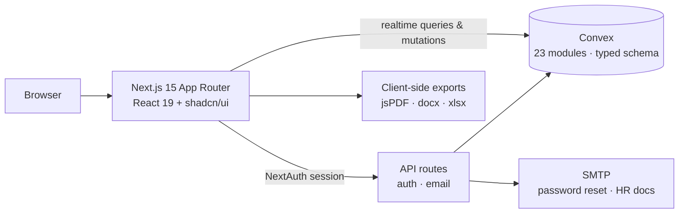

# WorkforceHub: HR, Attendance & Finance Platform


[](LICENSE)

An all-in-one operations platform for a small, site-based business such as an interior design studio. Employees, attendance, leave, HR paperwork, payroll, project sites, expenses and company money are managed in one real-time dashboard with role-based access.

> I built this for a real company. The public version uses a fictional brand ("Acme Interiors"), demo contact details and no production data or credentials.

## Features

| Module | What it does |
|---|---|
| **Auth & onboarding** | Email/password sign-in (NextAuth), OTP and password reset by email, invite links, join requests with admin approval, profile setup |
| **Roles & permissions** | Custom roles with per-permission toggles. Every page and Convex function checks the user's permissions, and suspended users are blocked |
| **Attendance** | Check-in and check-out with photo proof, a daily and monthly attendance table, custom status labels, PDF and Excel reports |
| **Leave & holidays** | Leave requests and approvals, a company holiday calendar, leave balances adjusted for holidays |
| **HR documents** | 14 templates (offer letter, appointment, experience, relieving, warning, NOC, salary certificate and more), each with `{{placeholders}}`. Exports to branded PDF and Word, can be emailed straight to the employee, and supports drafts |
| **Payroll** | Payslip generator with earnings and deductions breakdown and PDF export |
| **ID cards** | Employee ID cards with photo cropping and a QR code, exported as PNG or PDF |
| **Wallets & finance** | A central company wallet, per-site and personal wallets, fund transfers, expense requests with an approval workflow, a full transaction ledger, CSV financial reports |
| **Sites & projects** | Project sites with assets, tasks, requirements and vendors |
| **Estimation** | Client quotations with line items, auto-numbering, and PDF and Excel export |
| **Notices & notifications** | A company notice board and live in-app notifications |
| **UX** | Responsive and mobile-friendly, dark mode, built on shadcn/ui |

## Architecture



- **Convex** is the database and backend. It has a typed schema and real-time queries, so dashboards update live without polling. Permission checks run on the server inside each function.
- **NextAuth** handles sessions, using a custom Convex adapter in `lib/convex-adapter.ts`.
- **Documents are generated in the browser** with jsPDF, docx and xlsx, so the server doesn't need to render anything.

```
app/            Next.js routes (dashboard modules, auth, onboarding, API)
components/     dashboard feature components + shadcn/ui primitives
convex/         schema and backend functions (users, roles, attendance, leaves,
                wallets, transactions, hr_documents, estimation, sites, ...)
lib/            auth adapter, OTP helpers, shared types and utils
```

## Run locally

```bash
git clone https://github.com/lohithaksh123/workforce-hub.git
cd workforce-hub
npm install
cp .env.example .env.local   # fill in the values
npx convex dev               # creates a Convex deployment and pushes the schema
npm run dev
```

Open http://localhost:3000.

## Environment variables

See [`.env.example`](.env.example). You need:
- a Convex deployment
- a NextAuth secret
- SMTP credentials (for example a Gmail app password) for password reset and HR document emails

## Tech stack

TypeScript · Next.js 15 · React 19 · Convex · NextAuth · Tailwind CSS · shadcn/ui · Radix UI · React Hook Form · Zod · jsPDF · docx · SheetJS · Nodemailer

## License

MIT. See [LICENSE](LICENSE).
